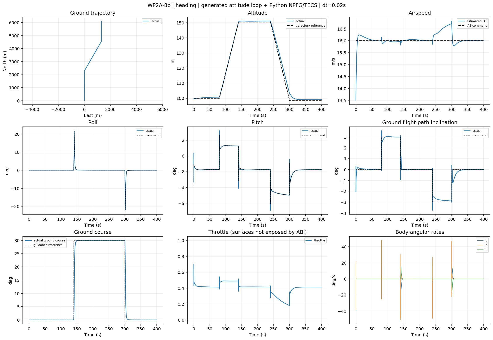
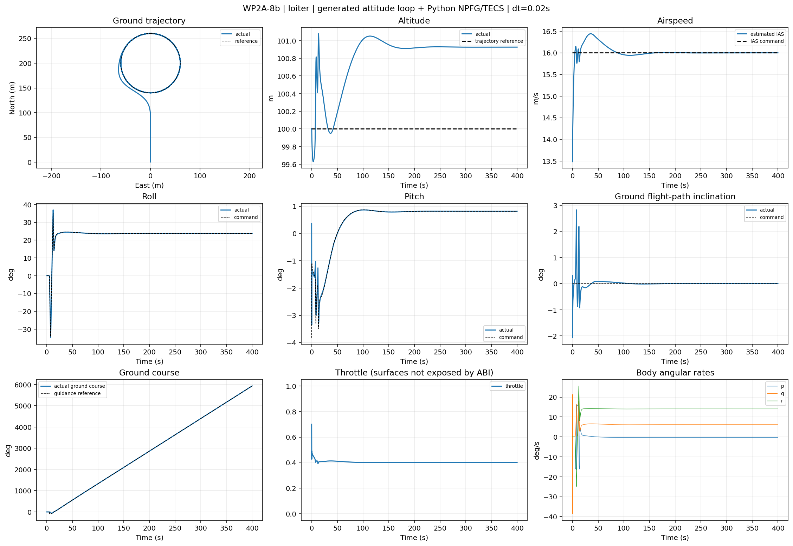
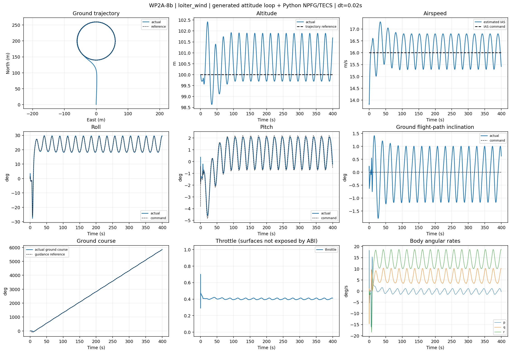
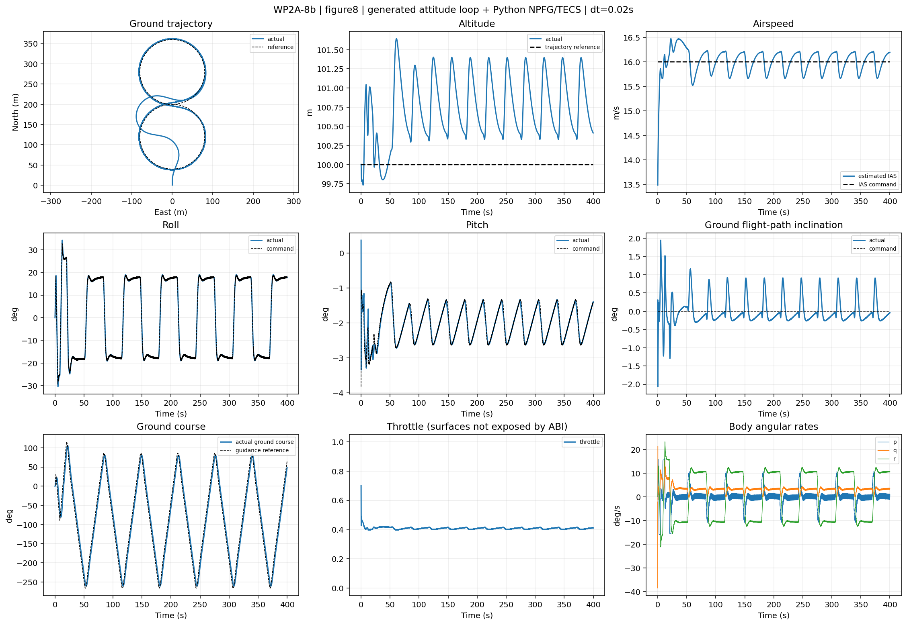

# WP2A-8b：生成姿态内环对象的动作接口与飞行品质

2026-11-03，Windows / Python 3.10 / `avanti2_att.dll`。完成直飞、指点盘旋和混合多实例接口接入；四项试验各运行400秒。当前结果支持该配置作为后续闭环试验基线，尚不构成全包线、实机或Gate A验收。

## 控制边界与调用方法

`python.controller.FlightController` 现在输出 `AttitudeCommand(phi, theta, throttle)`：滚转/俯仰单位rad，油门范围[0,1]。链路为Python批量NPFG/TECS → C++生成的姿态内环、协调偏航和6DOF。Python姿态PID不会重复参与。历史舵面输入试验显式使用 `LegacySurfaceFlightController`，原wp2a8入口保持旧对象。

```python
import numpy as np
from python.controller import HeadingCommand, LoiterCommand
from python.simulation.attitude_fleet import AttitudeFleet

with AttitudeFleet(batch=4, workers=4) as fleet:
    fc = fleet.controller
    fc.command_heading(HeadingCommand(16.0, 0.0, np.deg2rad(30)), indices=[0, 1])
    fc.command_loiter(LoiterCommand((200., 0., 100.), 16., 60.), indices=[2, 3])
    for _ in range(20000):  # 400秒，有界循环；默认风为0
        record = fleet.step()
```

也可单独实例化 `FlightController()`，`reset(batch)` 后输入 `ControlObservation`，每0.02秒调用 `step(obs, timestamp)`；其输出的 `to_inputs(wind_flat)` 可直接送到各原生模型handle。默认读取 [attitude_runtime.yaml](../../config/controller/attitude_runtime.yaml)。

| 动作 | 输入和语义 |
|---|---|
| `HeadingCommand(airspeed, gamma, chi, timestamp=0)` | IAS m/s；地面航迹倾角gamma rad，正为爬升；地面航迹偏角chi rad，从北向东为正；绝对仿真生效时刻s |
| `LoiterCommand(center, airspeed, radius, timestamp=0, direction=1)` | NEU圆心(N,E,Up)m；IAS m/s；半径m；绝对生效时刻；+1按N→E绕行，-1反向 |

`indices=None` 对整个batch生效，也可指定互不重复的实例索引。实例可混用两种模式；未来命令排队，到时间才激活。时间戳按实例单调，控制tick严格间隔0.02秒。相同的保持命令重复提交不会重新初始化参考或积分器；变更命令请填写新的时间戳，例如 `fleet.time`。非零epoch时也应使用绝对时间。

直飞直接跟踪航迹方向，不生成每tick随飞机移动的伪直线路径。首次进入heading时固定独立高度参考，此后按 `horizontal_ground_speed * tan(gamma)` 积分，gamma=0保持该参考；TECS同时接受爬升率前馈。更新heading不会把高度参考重新锚定到实际高度，避免累积漂移。

盘旋按 APPROACH → CAPTURE → HOLD 切换：先指向圆心，水平距离≤2R后锁定切圆，不因后续超出2R重新飞向圆心。HOLD要求径向误差≤15%R且切向航迹误差<30°；径向误差>30%R退回CAPTURE。半径取请求值、30m、`TAS_cmd²/(g*tan(bank_limit))` 三者最大值；这是无风近似机动性下界，未覆盖强顺风和瞬态超调的全部约束。

IAS由低马赫IAS≈EAS近似及ISA高度密度换算TAS。测试风速为已知值，未引入风估计噪声或传感器延迟模型。该换算不是完整空速计标定。

## GA参数迁移和修正依据

原GA参数来自 `experiments/wp2a8/tuning_04_multitask_ga/result.json`。旧Python内环与当前生成内环动态不同，直接复用TECS会触发明显俯仰交替限幅：80秒直飞基线中，30–80秒俯仰跟踪MAE为19.703°，指令逐tick变化RMS为3.675°。不能将该GA组当作新对象的已验证参数。

本次完整保留侧向数值：period=11.91322035s，damping=0.61863677，circle_kr=0.69656820，circle_kv=0.92250833；滚转指令限幅35°、变化率15°/s。TECS进行12组×45秒有限兼容性筛查，搜索trim∈{-2,0,2}°、balance_kp∈{0.3,0.6}、throttle_kp∈{0.06,0.15}。其余适配值及每组配置见 [筛查记录](tecs_compatibility_scan.json)，复现入口为 `tecs_compatibility_scan.py`。

45秒最低代价为balance_kp=0.6，但400秒含爬升/转向序列出现持续振荡，因此选择短窗代价接近、长序列更稳定的balance_kp=0.3组。最终TECS：theta_trim=-2°，energy_kp=0.3，throttle_kp/ki=0.15/0.04，airspeed_kp/ki=0.4/0.03，height_kp=0.15，balance_kp/ki=0.3/0.05，bank_comp_gain=0.1；其余值及限幅详见 [固定试验配置](candidate_config.json)。这是外环适配，未重新整定或写入原生内环14个增益。

切圆还需要结构修正：原径向PD+向心前馈无法可靠约束捕获时的朝向，曾出现大半径偏差。新公开 `circle_guidance()` 使用“切向方位+径向收敛场”的方向误差反馈，并叠加与方向对齐程度相关的曲率前馈；风三角修正参与实际滚转制导。circle_kr/kv数值沿用，但从直接加速度PD改为收敛场参数，不能视为控制律完全未变。旧 `L1Controller.step()` 的历史路径保持原实现。

8字试验继续使用弧长单调推进、局部投影、速度自适应前视和航迹指令变化率约束。200个离散点，双圆半径80m；前视时间2.5s、范围35–55m、航迹变化率18°/s、更新周期0.1s，经heading接口保持到下次更新。没有恢复25m固定航点到达门限，也未引入Dubins连接。

原GA直飞数据保存在 [ga_baseline](ga_baseline/)，短窗对照见 [same_window_comparison.json](same_window_comparison.json)。`compatibility_probes/balance_06` 和 `compatibility_probes/radial_pd_only` 保留中间失败方案，不能作为最终品质结果。

## 400秒试验结果

每项20000个正式控制/物理tick，另有1个初始化观测tick；50Hz，无Isaac并行依赖。IAS指令16m/s，初始高度100m。直飞在80/140/240/300秒调整gamma与chi，涵盖±3°爬降和30°转向；盘旋圆心(200,0,100)、R=60m；有风盘旋施加东向3m/s恒风。原始轨迹、配置及完整指标见 [quality_trials/summary.json](quality_trials/summary.json)。

| 工况 | IAS RMSE m/s | 高度RMSE m | 侧向/航迹品质 |
|---|---:|---:|---|
| 直飞 | 0.211 | 1.517 | 稳态chi RMSE 0.0237°；gamma RMSE 0.1013° |
| 无风指点盘旋 | 0.109 | 0.889 | 稳态径向MAE 0.00668m；P95 0.00898m |
| 3m/s风盘旋 | 0.574 | 1.026 | 稳态径向MAE 0.173m；P95 0.338m |
| heading接口8字 | 0.208 | 0.858 | 路径横侧MAE 2.263m；P95 4.266m；完成6圈 |

一般速度/高度/姿态指标使用t>30s；盘旋径向指标使用t>max(60s,首次HOLD+20s)；8字横侧指标使用t>60s；直飞航迹角指标另排除每次命令变更后10s。因此上述侧向精度不代表从启动到捕获的全程误差。盘旋首次切圆距离分别119.784m、119.753m，符合2R=120m；首次HOLD分别8.94s、9.14s，只代表第一次满足门限。8字弧长进度单调。






四项实际对象输出均有限；t>30s油门处于边界的比例均为0。仍有转弯切换造成的高度/空速周期波动；有风盘旋IAS及纵向波动尤其明显。无风切圆实际滚转峰值约37.01°，高于35°指令限幅；内环存在瞬态超调，不能把指令限幅解释为状态硬约束。实际p/q/r曲线也应继续作为内环品质诊断依据。

当前ABI没有舵面遥测，饱和指标明确记录null；不能据此证明舵面无饱和或无高频抖动，也没有将实际角速率伪装为角速率期望。姿态欧拉角相对NEU参考，p/q/r为机体系角速度。Linux SO尚未在本轮执行。

## 多实例与状态边界

`FlightController` 的数值外环按batch计算，各实例独立保存模式、积分器、高度参考、命令时序和切圆状态。命令入队按索引分发；原生推进各用独立handle。`AttitudeFleet(workers>1)` 使用持续存在的线程池推进C ABI，ctypes调用释放GIL。4实例混合模式、不同风/航迹/爬降命令，30秒串行与4线程轨迹逐值相同，最大绝对差0，见 [parallel_check.json](parallel_check.json)。

本机该小批量实测串行0.914s、线程1.265s，加速比0.723，线程开销更大；默认workers=1。此结果验证隔离性和并行可用性，不承诺加速，后续大批量应重新benchmark。路径采样器 `PolylinePathFollower` 仍是一实例一对象，本次没有把它改成批量路径采样器。

生成内环14个增益是进程共享参数，创建/推进实例期间应冻结；本次写入次数为0。编译默认角度P均6.5，rollFF=33.0766501559、pitchFF=73.5591994785，使用的是当前DLL实际值，而非历史IA报告。完整值在summary及provenance.json中。

Fleet初始化先获取原生major tick观测，再由上一观测计算下一个tick外环输出，形成约一tick观测延迟；生成内环仍在当前native tick使用内部状态。输入风是flat-Earth向下为正，观测风转换NEU。`FlightController.get_snapshot()` 仅覆盖Python外环和动作状态，不能克隆C++飞机；原生完整snapshot/clone仍待ABI扩展。

## 复现

在项目根目录执行（Windows使用python；Ubuntu构建SO后换用当地Python命令）：

```powershell
python python/tests/test_attitude_api.py
python python/tests/test_controller_interfaces.py
python experiments/wp2a8b/quality_trials.py --profile adapted --trial all --seconds 400
python experiments/wp2a8b/parallel_check.py
# 可选：重做12组短窗筛查，结果单独保存，不覆盖历史选择记录
python experiments/wp2a8b/tecs_compatibility_scan.py
# 可选：重做未适配GA直飞基线
python experiments/wp2a8b/quality_trials.py --profile ga --trial heading --seconds 80
```

文件 `provenance.json` 保存结果所用DLL、源文件、配置和数据SHA256。当前结论：生成内环与重新适配的外环已可组成稳定的限定工况控制基线；下一步优先减少侧风纵向周期误差、开放舵面遥测，再扩大速度/高度/风和机动性验证范围。
